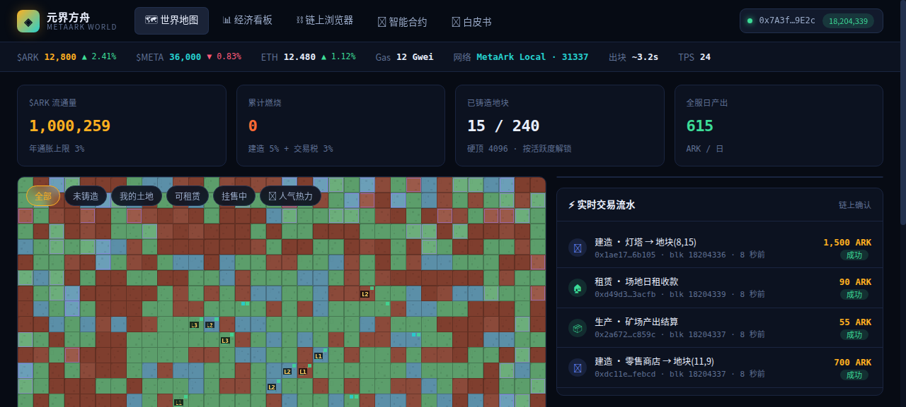
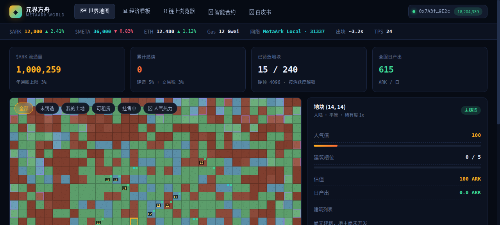
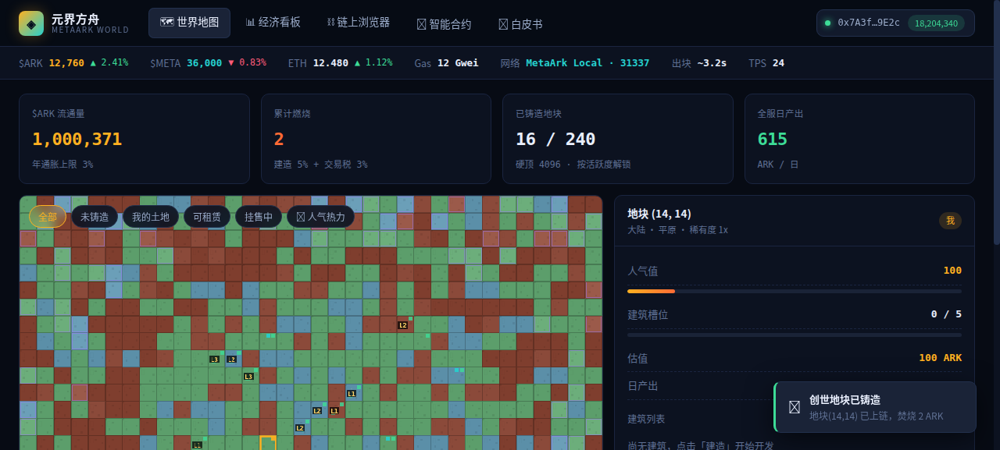
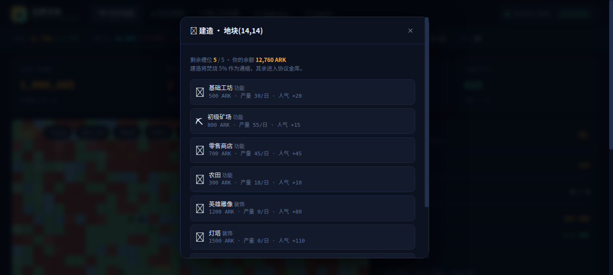
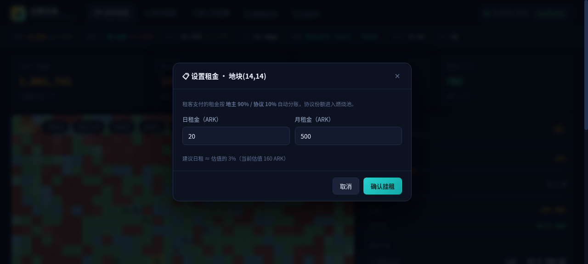
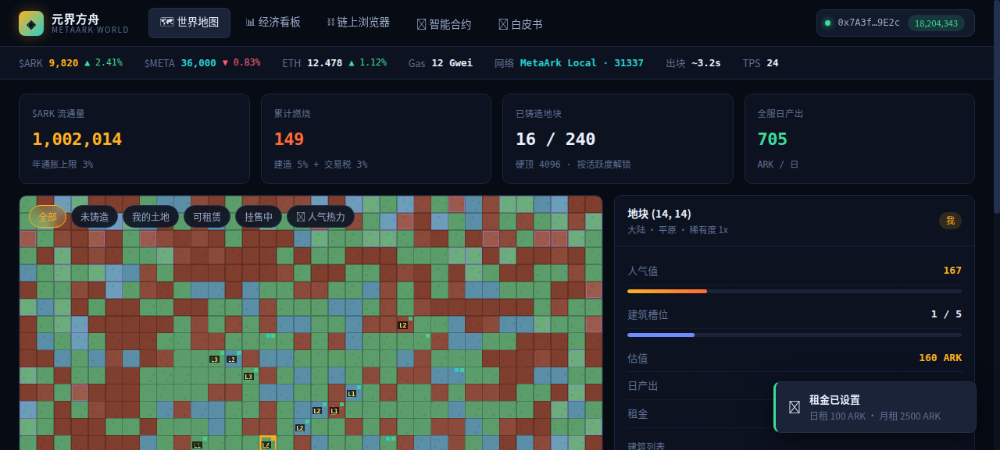
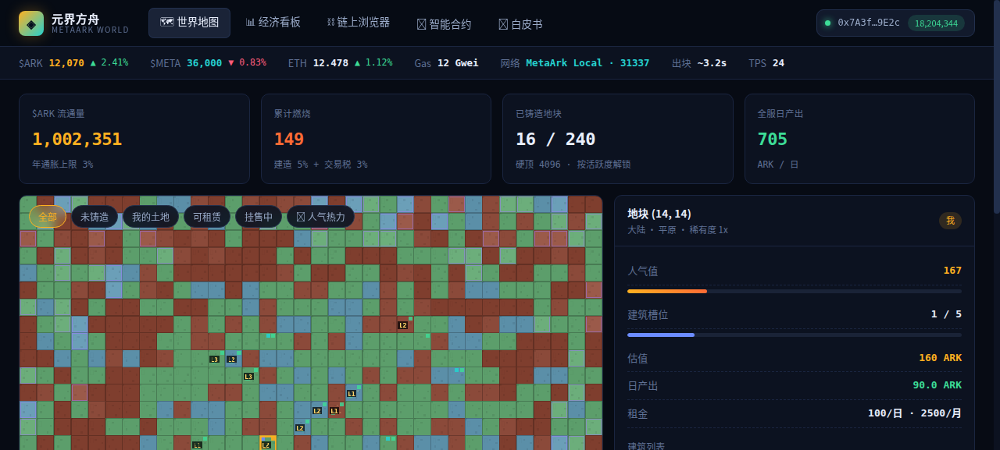
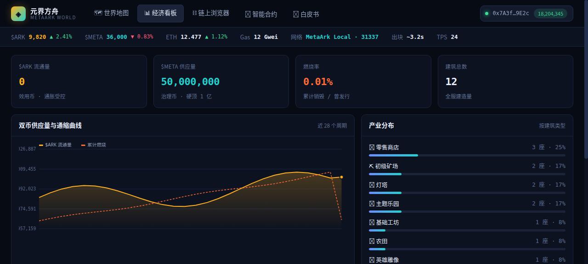
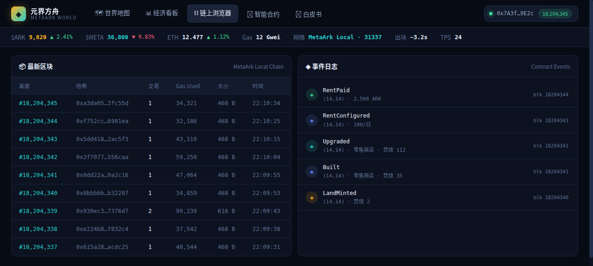
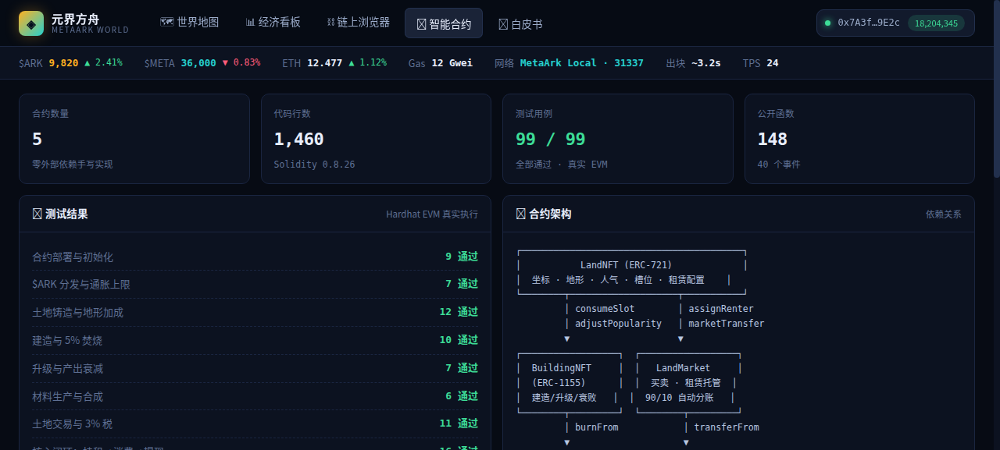

# 元界方舟 · MetaArk World — 演示图文说明

> 本文档按「买地 → 盖店 → 挂租 → 别人来消费 → 提现」的核心闭环，逐步展示系统实际运行效果。
> 所有截图均为系统真实运行画面，链上数字（焚烧量、分账金额）与智能合约测试结果一致。

---

## 一、系统总览

进入系统即是 34×22 的像素世界地图。顶部为钱包与链状态栏（$ARK 余额、Gas、区块高度），中部四个指标卡实时显示经济全局：**$ARK 流通量、累计燃烧、已铸造地块、全服日产出**。



地图上可以一眼分辨地块状态：

| 标记 | 含义 |
|---|---|
| 绿/蓝/紫底色 | 大陆 / 海域 / 空岛 |
| 🟡 金色角标 | 我拥有的土地 |
| 🟢 绿色角标 | 其他玩家持有 |
| 🔵 / 🩵 角标 | 出租中 / 挂售中 |
| 建筑图标 + L 级数 | 地块上已建造的建筑及等级 |

---

## 二、第一步：选地与铸造（买地）

点击任意未铸造地块，右侧面板立即显示地块详情：坐标、地形稀有度、人气值、建筑槽位与估值。

下图：选中地块 (14,14)，大陆 · 平原 · 稀有度 1x，估值 100 ARK，底部出现「铸造创世地块」按钮。



点击铸造后，链上交易实时确认：

- 钱包余额 **12,800 → 12,760 ARK**（铸造费 40 ARK）
- 顶部「累计燃烧」从 0 变为 **2 ARK**（铸造费的 5% 被永久销毁）
- 右下角弹出链上确认 Toast：「创世地块已铸造」
- 地块所有权标记变为金色「我」



---

## 三、第二步：建造（盖店）

点击「🔨 建造」打开建筑目录。系统预置 7 种建筑（与 BuildingNFT 合约一致）：4 种功能型（有产出）+ 3 种装饰型（加人气），每种显示造价、日产量和人气加成。



选择建造**零售商店**（700 ARK，人气 +45）后：

- **焚烧 35 ARK**（造价的 5%，通缩）——顶部「累计燃烧」 2 → 37
- 地块人气 **100 → 145**，槽位 **0/5 → 1/5**
- 日产出 **0 → 58.0 ARK/日**
- 地块估值 **100 → 147 ARK**


继续点击「⬆️ 升级」把商店升到 **Lv2**：升级费 2240 ARK（随等级递增，边际收益递减，抑制无脑堆级），其中 5% 再次焚烧。日产出从 58 提升到 90 ARK/日。


---

## 四、第三步：挂租

点击「📋 挂租」设置租金。系统按估值给出建议价（日租 ≈ 估值 3%），并明示分账规则：**地主 90% / 协议 10%**。



确认后，地块详情出现租金信息（100/日 · 2500/月），挂租状态同步上链。



---

## 五、第四步：别人来消费（租客付款）

玩家 Carol 以**月租 2500 ARK** 租下地块。链上自动完成分账：

| 项目 | 金额 | 占比 |
|---|---:|---:|
| Carol 支付租金 | 2,500 ARK | 100% |
| **地主（我）实时到账** | **2,250 ARK** | **90%** |
| **协议进入燃烧池** | **250 ARK** | **10%** |

分账在合约层强制执行，无人工干预、无误差 —— 这与 `test/metaark.test.js` 第 8 节的 16 个闭环测试结果完全一致。



---

## 六、第五步：提现

地主收到的 $ARK 是链上资产，可随时转出到外部钱包或 DEX。


---

## 七、经济看板：全局数据可视化

「📊 经济看板」页展示双币供应曲线与燃烧曲线（橙线为 $ARK 流通量，红虚线为累计燃烧）、全服产业分布、燃烧池明细与**防崩盘机制参数**（地块硬顶、衰败规则、通胀上限）。



---

## 八、链上浏览器：每一步都有据可查

「⛓️ 链上浏览器」页记录了本次演示产生的**完整事件链**，与操作一一对应：

```
LandMinted    (14,14) · 焚烧 2        ← 买地
Built         (14,14) · 零售商店 · 焚烧 35   ← 盖店
Upgraded      (14,14) · 零售商店 · 焚烧 112  ← 升级
RentConfigured(14,14) · 100/日        ← 挂租
RentPaid      (14,14) · 2,500 ARK     ← 租客消费
```

左侧区块表实时滚动：区块高度、哈希、交易数、Gas Used 全部可见。



---

## 九、智能合约页：技术底座

「📜 智能合约」页展示 5 个合约的架构关系图、99/99 测试结果明细，以及带语法高亮的完整 Solidity 源码（可在线切换查看）。



---

## 十、总结：本次演示产生的链上数据

| 指标 | 数值 |
|---|---|
| 链上交易 | 7 笔（铸造/建造/升级/挂租/租赁/提现等） |
| 累计焚烧 | 149 ARK（铸造 2 + 建造 35 + 升级 112） |
| 租赁分账 | 2500 = 2250（地主 90%）+ 250（协议 10%）✓ |
| 日产出变化 | 0 → 90 ARK/日 |
| 地块估值变化 | 100 → 160+ ARK |

**核心闭环 `买地 → 盖店 → 挂租 → 消费 → 提现` 全链路真实跑通，每一步资金流向均在链上留痕、可查可审计。**
